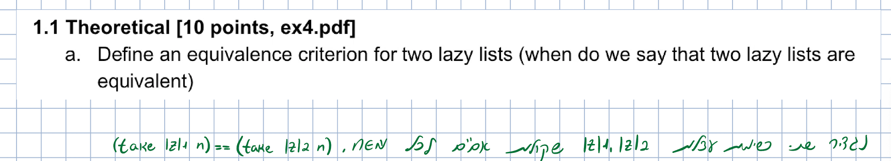
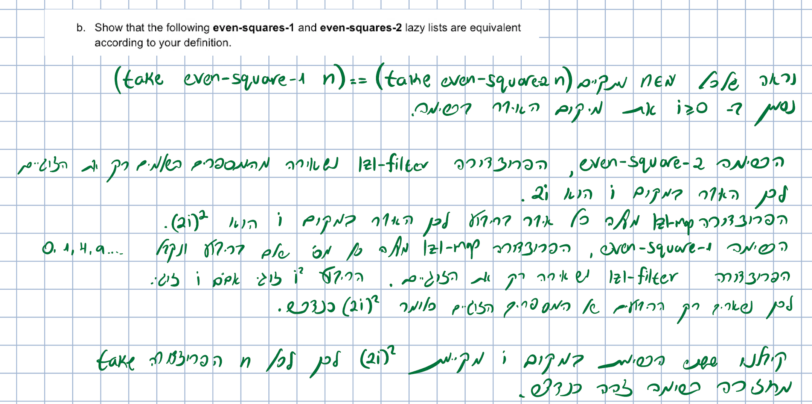

## Question 1: Lazy lists [25 points]

Submit your answers to the theoretical questions in a pdf file called `ex4.pdf`.

### [10 points] Question 1.1: Theoretical

- a. Define an equivalence criterion for two lazy lists (when do we say that two lazy lists are equivalent)
- b. Show that the following **even-squares-1** and **even-squares-2** lazy lists are equivalent according to your definition.

```scheme
(define integers-from
  (lambda (n)
    (cons-lzl n (lambda () (integers-from (+ n 1))))))

(define lzl-map
  (lambda (f lzl)
    (if (empty-lzl? lzl)
        lzl
        (cons-lzl (f (head lzl))
                  (lambda () (lzl-map f (tail lzl)))))))

(define lzl-filter
  (lambda (p lzl)
    (cond ((empty-lzl? lzl) lzl)
          ((p (head lzl)) (cons-lzl (head lzl)
                                    (lambda () (lzl-filter p (tail lzl)))))
          (else (lzl-filter p (tail lzl))))))

(define even-square-1
  (lzl-filter (lambda (x) (= (modulo x 2) 0))
              (lzl-map (lambda (x) (* x x))
                       (integers-from 0))))

(define even-square-2
  (lzl-map (lambda (x) (* x x))
           (lzl-filter (lambda (x) (= (modulo x 2) 0))
                       (integers-from 0))))
```

#### סעיף a

**Answer (handwritten):** see also `ex4.pdf` / `images/HW4Q1.1a.png`.



**Answer (typed):**

נגדיר שתי רשימות עצלות `lzl1`, `lzl2` שקולות אמ"מ לכל $n \in \mathbb{N}$ מתקיים:

```scheme
(take lzl1 n) == (take lzl2 n)
```

#### סעיף b

**Answer (handwritten):** see also `ex4.pdf` / `images/HW4Q1.1b.png`.



**Answer (typed):**

נראה שלכל $n \in \mathbb{N}$ מתקיים:

```scheme
(take even-square-1 n) == (take even-square-2 n)
```

נסמן ב- $i \geq 0$ את מיקום האיבר ברשימה.

הרשימה `even-square-2`, הפרוצדורה `lzl-filter` משאירה מהמספרים השלמים רק את הזוגיים לכן האיבר במקום $i$ הוא $2i$.

הפרוצדורה `lzl-map` מעלה כל איבר בריבוע לכן האיבר במקום $i$ הוא $(2i)^2$.

הרשימה `even-square-1`, הפרוצדורה `lzl-map` מעלה כל מס' שלם בריבוע ונקבל $0, 1, 4, 9, \dots$

הפרוצדורה `lzl-filter` משאירה רק את הזוגיים. הריבוע $i^2$ זוגי אמ"מ $i$ זוגי.

לכן נשארים רק הריבועים של המספרים הזוגיים כלומר $(2i)^2$ כנדרש.

קיבלנו ששתי הרשימות במקום $i$ מקיימות $(2i)^2$ לכן לכל $n$ הפרוצדורה `take` מחזירה רשימה זהה כנדרש.
