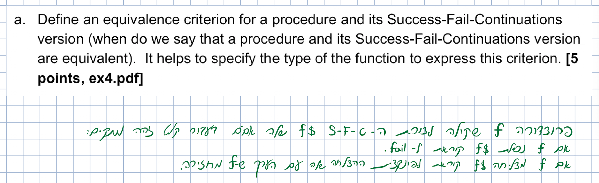
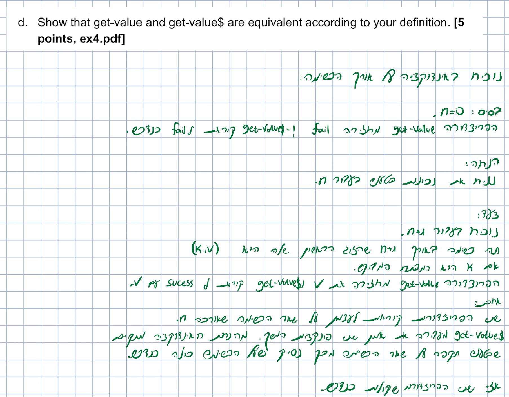

## Question 2: CPS [25 points]

### [5 points] Question 2.a

Define an equivalence criterion for a procedure and its Success-Fail-Continuations version (when do we say that a procedure and its Success-Fail-Continuations version are equivalent). It helps to specify the type of the function to express this criterion.

**Answer (handwritten):** see also `ex4.pdf` / `images/HW4Q2a.png`.

**Answer (typed):**

פרוצדורה `f` שקולה לגרסת ה-S-F-C שלה `f$` אמ"מ בעבור קלט זהה מתקיים:

אם `f` נכשלת `f$` קוראת ל-`fail`.

אם `f` מצליחה `f$` קוראת לפונקציית ההצלחה שלה עם הערך ש-`f` מחזירה.

### [5 points] Question 2.d

Show that `get-value` and `get-value$` are equivalent according to your definition.

**Answer (handwritten):** see also `ex4.pdf` / `images/HW4Q2d.png`.

**Answer (typed):**

נוכיח באינדוקציה על אורך הרשימה:

#### בסיס: n=0

הפרוצדורה `get-value` מחזירה `fail` ו-`get-value$` קוראת ל-`fail` כנדרש.

#### הנחה

נניח את נכונות הטענה בעבור n.

#### צעד

נוכיח בעבור n+1.

תהי רשימה באורך n+1 שהזוג הראשון שלה הוא `(k,v)`.

אם `k` הוא המפתח המבוקש:

הפרוצדורה `get-value` מחזירה את `v` ו-`get-value$` קוראת ל-`success` עם `v`.

אחרת:

שתי הפרוצדורות קוראות לעצמן על שאר הרשימה שאורכה n.

‏`get-value$` מעבירה את אותן שתי פונקציות המשך. מהנחת האינדוקציה מתקיים שהטענה תקפה על שאר הרשימה מכך נסיק שעל הרשימה כולה כנדרש.

אזי שתי הפרוצדורות שקולות כנדרש.
