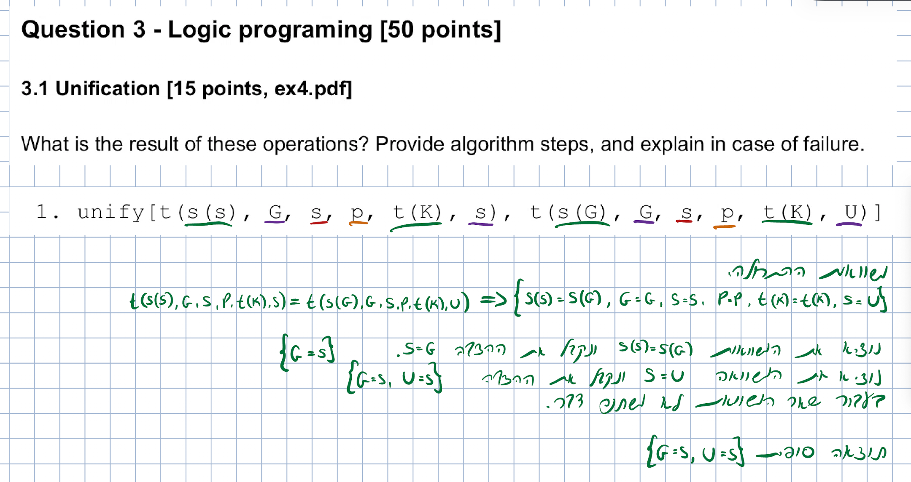
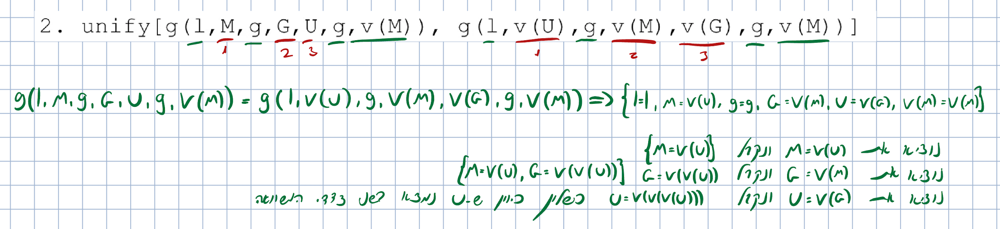
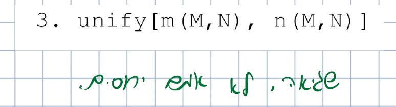
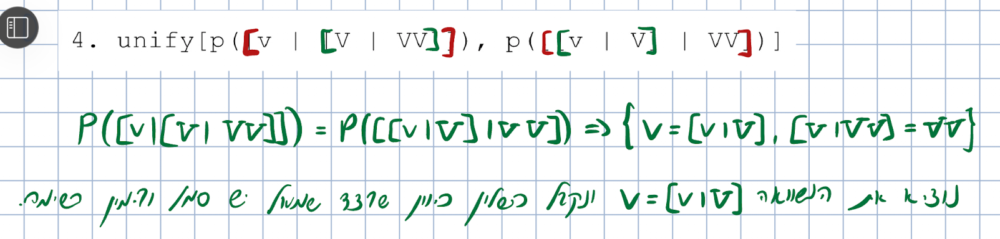
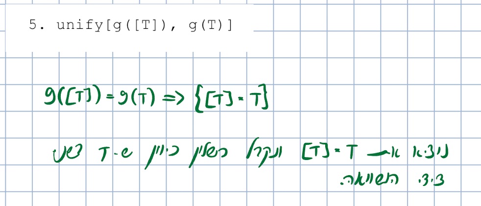
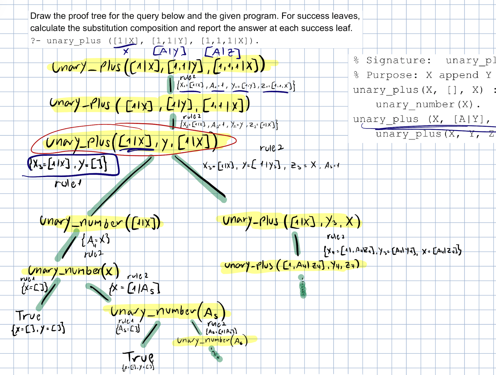
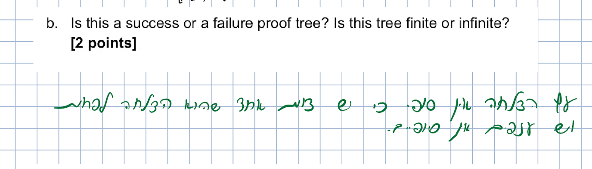
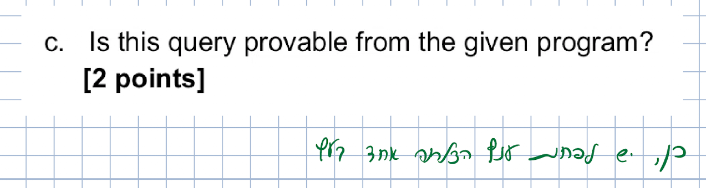
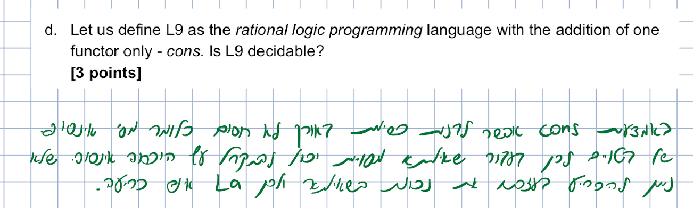

## Question 3: Logic programing [50 points]

### [15 points] Question 3.1: Unification

What is the result of these operations? Provide algorithm steps, and explain in case of failure.

1. `unify[t(s(s), G, s, p, t(K), s), t(s(G), G, s, p, t(K), U)]`
2. `unify[g(l,M,g,G,U,g,v(M)), g(l,v(U),g,v(M),v(G),g,v(M))]`
3. `unify[m(M,N), n(M,N)]`
4. `unify[p([v | [V | VV]]), p([[v | V] | VV])]`
5. `unify[g([T]), g(T)]`

#### ביטוי 1

```prolog
unify[t(s(s), G, s, p, t(K), s), t(s(G), G, s, p, t(K), U)]
```

**Answer (handwritten):** see also `ex4.pdf` / `images/HW4Q3.1.1.png`.



**Answer (typed):**

משוואות ההתחלה:

```
t(s(s),G,s,p,t(K),s) = t(s(G),G,s,p,t(K),U)  =>  {s(s)=s(G), G=G, s=s, p=p, t(K)=t(K), s=U}
```

נוציא את המשוואה `s(s)=s(G)` ונקבל את ההצבה `s=G`.

```
{G=s}
```

נוציא את המשוואה `s=U` ונקבל את ההצבה:

```
{G=s, U=s}
```

בעבור שאר המשוואות לא משתנה דבר.

תוצאה סופית:

```
{G=s, U=s}
```

#### ביטוי 2

```prolog
unify[g(l,M,g,G,U,g,v(M)), g(l,v(U),g,v(M),v(G),g,v(M))]
```

**Answer (handwritten):** see also `ex4.pdf` / `images/HW4Q3.1.2.png`.



**Answer (typed):**

```
g(l,M,g,G,U,g,v(M)) = g(l,v(U),g,v(M),v(G),g,v(M))  =>  {l=l, M=v(U), g=g, G=v(M), U=v(G), v(M)=v(M)}
```

נוציא את `M=v(U)` ונקבל:

```
{M=v(U)}
```

נוציא את `G=v(M)` ונקבל `G=v(v(U))`:

```
{M=v(U), G=v(v(U))}
```

נוציא את `U=v(G)` ונקבל `U=v(v(v(U)))` כשלון כיוון ש-`U` נמצא בשני צידי המשוואה.

#### ביטוי 3

```prolog
unify[m(M,N), n(M,N)]
```

**Answer (handwritten):** see also `ex4.pdf` / `images/HW4Q3.1.3.png`.



**Answer (typed):**

שגיאה, לא אותם יחסים.

#### ביטוי 4

```prolog
unify[p([v | [V | VV]]), p([[v | V] | VV])]
```

**Answer (handwritten):** see also `ex4.pdf` / `images/HW4Q3.1.4.png`.



**Answer (typed):**

```
p([v|[V|VV]]) = p([[v|V]|VV])  =>  {v=[v|V], [V|VV]=VV}
```

נוציא את המשוואה `v=[v|V]` ונקבל כשלון כיוון שמצד שמאל יש סמל ובימין רשימה.

#### ביטוי 5

```prolog
unify[g([T]), g(T)]
```

**Answer (handwritten):** see also `ex4.pdf` / `images/HW4Q3.1.5.png`.



**Answer (typed):**

```
g([T]) = g(T)  =>  {[T]=T}
```

נוציא את `[T]=T` ונקבל כשלון כיוון ש-`T` בשני צידי המשוואה.

### [15 points] Question 3.3: Proof tree

_Unary numbers_ provide symbolic representation for the natural numbers. They are defined inductively as follows: zero is the atom `[]`, and for a Unary number c, `[1|c]` represents the number c+1. The numbers 0, 1, 2, 3 etc. are represented by the terms `[]`, `[1]`, `[1, 1]`, `[1, 1, 1]`, and so forth.

The following program is given.

```prolog
% Signature: unary_number(L)/1
% Purpose: L is a unary number
unary_number([]).                 %1
unary_number([1|A]) :-            %2
    unary_number(A).

% Signature: unary_plus(X,Y,Z)/3
% Purpose: X append Y = Z
unary_plus(X, [], X) :-           %1
    unary_number(X).
unary_plus(X, [A|Y], [A|Z]) :-    %2
    unary_plus(X, Y, Z).
```

- a. [8 points] Draw the proof tree for the query below and the given program. For success leaves, calculate the substitution composition and report the answer at each success leaf.

  ```prolog
  ?- unary_plus([1|X], [1,1|Y], [1,1,1|X]).
  ```

- b. [2 points] Is this a success or a failure proof tree? Is this tree finite or infinite?
- c. [2 points] Is this query provable from the given program?
- d. [3 points] Let us define L9 as the _rational logic programming_ language with the addition of one functor only - _cons_. Is L9 decidable?

#### סעיף a

**Answer (handwritten):** see also `ex4.pdf` / `images/HW4Q3.3a.png`.



**Answer (typed):**

- `unary_plus([1|X], [1,1|Y], [1,1,1|X])`
  - rule 2, `{X1=[1|X], A1=1, Y1=[1|Y], Z1=[1,1|X]}`: `unary_plus([1|X], [1|Y], [1,1|X])`
    - rule 2, `{X2=[1|X], A2=1, Y2=Y, Z2=[1|X]}`: `unary_plus([1|X], Y, [1|X])`
      - rule 1, `{X3=[1|X], Y=[]}`: `unary_number([1|X])`
        - rule 2, `{A4=X}`: `unary_number(X)`
          - rule 1, `{X=[]}`: True, `{X=[], Y=[]}`
          - rule 2, `{X=[1|A5]}`: `unary_number(A5)`
            - rule 1, `{A5=[]}`: True, `{X=[1], Y=[]}`
            - rule 2, `{A5=[1|A6]}`: `unary_number(A6)`
              - ...
      - rule 2, `{X3=[1|X], Y=[1|Y3], Z3=X, A3=1}`: `unary_plus([1|X], Y3, X)`
        - rule 2, `{X4=[1,A4|Z4], Y3=[A4|Y4], X=[A4|Z4]}`: `unary_plus([1,A4|Z4], Y4, Z4)`
          - ...

#### סעיף b

**Answer (handwritten):** see also `ex4.pdf` / `images/HW4Q3.3b.png`.



**Answer (typed):**

עץ הצלחה אין סופי כי יש צומת אחד שהוא הצלחה לפחות ויש ענפים אין סופיים.

#### סעיף c

**Answer (handwritten):** see also `ex4.pdf` / `images/HW4Q3.3c.png`.



**Answer (typed):**

כן, יש לפחות ענף הצלחה אחד בעץ.

#### סעיף d

**Answer (handwritten):** see also `ex4.pdf` / `images/HW4Q3.3d.png`.



**Answer (typed):**

באמצעות `cons` אפשר לבנות רשימות באורך לא חסום כלומר מס' אינסופי של ביטויים לכן בעבור שאילתא מסוימת יכול להתקבל עץ הוכחה אינסופי שלא ניתן להכריע בעזרתו את נכונות השאילתה ולכן L9 אינה כריעה.
